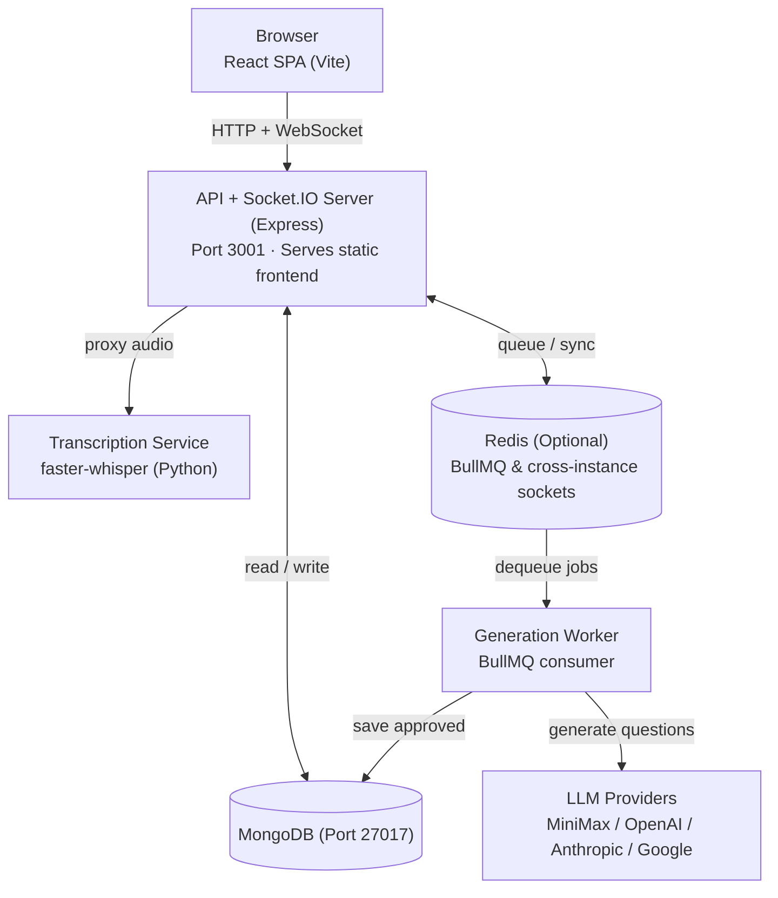

# ⚡ Spandan

> Real-time classroom polling with LLM-generated questions, streak celebrations, and live teacher analytics.

Spandan is a modern web platform for running live, interactive classroom polls and lectures. A teacher speaks, or plays a YouTube video to the room; audio is transcribed; a large language model generates poll questions from the live transcript; the teacher approves them; students answer live on their own devices; and the room sees real-time results, anonymous doubts, and dynamic leaderboards.

---

## ⚡ 1-Click Installation (No Coding Required)

We provide ultra-lightweight, 1-click web installers for all major desktop platforms:

| Platform | Release Installer File | Description |
| :--- | :--- | :--- |
| **🪟 Windows** | **[`asset/Spandan_Windows_Setup.exe`](./asset/Spandan_Windows_Setup.exe)** | 1-Click native installer. Installs app, creates Desktop shortcut, and opens in browser. |
| **🍏 macOS** | **[`asset/Spandan_macOS_arm64.dmg`](./asset/Spandan_macOS_arm64.dmg)** | Apple Silicon (M1/M2/M3/M4) Disk Image containing `Spandan.app`. Drag to Applications. |
| **🐧 Linux** | **[`asset/spandan_1.0.0_amd64.deb`](./asset/spandan_1.0.0_amd64.deb)** | Debian/Ubuntu package with desktop launcher and `/opt/spandan`. |

> **Note**: Official installable binaries are also downloadable from [GitHub Releases](https://github.com/Bhimashri-Deka/spandan/releases).

---

## ✨ Features

- **Live Polling** — Multiple-choice (MCQ), True/False (TF), and Multi-Select (MSQ) questions pushed in real time over Socket.IO with timers and decay scoring.
- ⚡ **Multi-Question Quiz Mode & Save & Next** — Teachers can launch entire question banks at once. Students answer Question 1, see countdown timers, receive instant streak feedback with confetti, and advance seamlessly with `Save & Next Question` to Question 2, 3, etc., culminating in a quiz completion celebration card.
- 📄 **Upload PDF / Document to Questions** — Upload course syllabi, lecture slides, notes, or assignment PDFs to automatically extract text and generate 5, 10, 15, or 20 formatted questions in 1 click without manual typing.
- ➕ **Save & Add Another Question** — Create 10–15 questions back-to-back without closing the creation modal.
- 🔥 **Streaks & Confetti** — Server-verified consecutive correct answer streaks visible in the header and question cards with celebration confetti milestones (3, 5, 10, 20) and fiery glow (`🔥 3 Streak — On Fire!`).
- 🗂️ **Collapsible Sidebar & Quick Navigation** — 1-click toggle between full view with labels and a compact 76px icon-only rail. Tapping the Spandan logo navigates directly to the user's dashboard.
- ❓ **"I'm Confused" Student Signal** — Students can tap the confusion icon anytime during class to signal the teacher with an optional private note explaining their confusion. The teacher receives an instant alert banner with expandable notes.
- 💬 **Anonymous Doubt Box** — Students submit doubts with 100% peer anonymity. Supports idempotent upvoting (students cannot manipulate vote counts), oldest-first tie breaking, and teacher moderation (mark as addressed / delete).
- 📊 **Questions to Revise** — Dedicated teacher analytics section highlighting the lowest-accuracy questions first so teachers know exactly which topics need revision.
- 📋 **Duplicate Room** — Teachers can clone an entire room's settings and approved questions in 1 click, generating a clean `(Copy)` room with a fresh code and zero student/response baggage.
- 🤖 **LLM Question Generation** — Automatically generates relevant poll questions from the live lecture transcript. Supports MiniMax, OpenAI, Anthropic, and Google Gemini via BullMQ background queue or synchronous fallback.
- 🎥 **Synchronized Video Mode** — Embed YouTube lectures with synchronized playback, seek-ahead restrictions past the teacher, and automatic pause during active poll windows.
- 🏆 **Live Results & Masked Leaderboards** — Instant streaming responses, per-segment leaderboard folds, and optional anonymous leaderboard masking (`Anonymous #rank`).
- 🔐 **Role-Based Auth** — Email/password with OTP registration, Google OAuth 2.0, password reset, and Teacher approval flow by Admin.
- 📥 **Data Exports** — One-click Teacher CSV session export and key-protected Research JSON/CSV exports (`X-Research-Key`).

---

## 🏗️ Architecture



---

## 🛠️ Local Development (Developers)

Spandan is organized as an npm-workspaces monorepo (`frontend` + `backend`).

### 1. Prerequisites
- **Node.js 20+** and npm
- **MongoDB** running on `mongodb://127.0.0.1:27017`
- *(Optional)* Redis for background BullMQ worker
- *(Optional)* Python 3 with faster-whisper for audio transcription

### 2. Install Dependencies
```bash
npm install
```

### 3. Environment Configuration
Copy the configuration templates:
```bash
cp backend/.env.example backend/.env
cp frontend/.env.example frontend/.env
```
Key backend variables (`backend/.env`):
- `PORT=3001`
- `MONGODB_URI=mongodb://127.0.0.1:27017/spandan`
- `JWT_SECRET=your-super-secret-jwt-key`
- `CORS_ORIGINS=http://localhost:5173,http://localhost:3001`
- `SPANDAN_ADMIN_EMAILS=teacher@spandan.test` *(Auto-approves the first admin)*

### 4. Start Development Servers
```bash
# Starts both frontend (port 5173) and backend (port 3001) concurrently:
npm run dev
```
- **Frontend App**: `http://localhost:5173/`
- **Backend API**: `http://localhost:3001/api/`

### 5. Production Single-Port Serving
The backend can serve both the API and the pre-built React frontend bundle from a single port (`3001`):
```bash
npm run build --workspace=frontend
cd backend && node src/index.js
```
Open **`http://localhost:3001/`** in your browser!

---

## 🧪 Testing

Both backend and frontend have comprehensive automated test suites:

```bash
# Run backend tests (in-memory MongoDB, 214 tests):
npm test --workspace=backend

# Run frontend tests (React Testing Library + Jest, 219 tests):
npm test --workspace=frontend
```

---

## 📂 Repository Structure

```
spandan/
├── Spandan_Setup_Windows.exe       # 25 KB Windows 1-Click Online Installer
├── Spandan_Setup_macOS.command      # 3.4 KB macOS 1-Click Online Installer
├── Spandan_Setup_Linux.sh          # 4.1 KB Linux 1-Click Online Installer
├── frontend/                       # React 18 SPA (Vite + TailwindCSS + Zustand)
│   ├── src/
│   │   ├── pages/                  # Auth, RoomDetail, Dashboard, Admin pages
│   │   ├── components/             # ConfusedButton, DoubtBox, Streaks, Leaderboard
│   │   └── services/               # API & Socket clients
│   └── public/                     # Icons & assets
├── backend/                        # Node.js Express API & Socket.IO
│   ├── src/
│   │   ├── index.js                # Server entry point + static frontend hosting
│   │   ├── routes/                 # REST APIs (auth, rooms, questions, doubts)
│   │   ├── models/                 # Mongoose schemas (Room, Question, Doubt, User)
│   │   └── services/               # Scoring, streaks, doubt sorting, LLM generation
│   ├── transcription_server.py     # Python faster-whisper STT service
│   └── requirements.txt
├── package.json                    # Monorepo workspaces config
└── README.md                       # Documentation
```

---

## 👥 Default Test Accounts (Local Demo)

When running locally with the auto-seeder, the following test credentials are ready to use:

- **Teacher Account**:
  - Email: `teacher@spandan.test`
  - Password: `Password123!`
- **Student Account**:
  - Email: `student@spandan.test`
  - Password: `Password123!`
- **Pre-configured Test Room**: `TEST99`

---

## 📄 License

Distributed under the MIT License. See [LICENSE](LICENSE) for more information.
